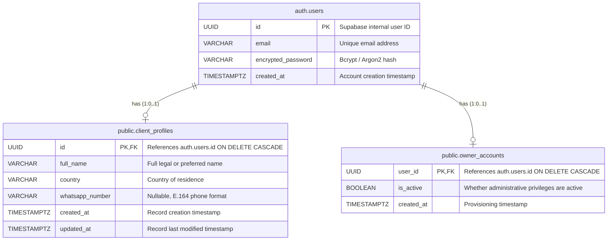

# Database Architecture & Security Design

**Target Database:** PostgreSQL 14+ (Supabase Managed Engine)  
**Schema Version:** 1.0.0  
**Migration Scripts:** `backend/migrations/001_initial_schema.sql`, `backend/migrations/002_rls_policies.sql`

---

## 1. Architectural Philosophy & Isolation

The system separates standard clients from administrative company owners at both the **schema layer** and the **policy layer (Row Level Security)**.

- **`auth.users`:** Built-in Supabase authentication table managing credentials, password hashes, email confirmations, and raw authentication tokens.
- **`public.client_profiles`:** Customer-facing profile metadata. Created upon client registration.
- **`public.owner_accounts`:** Internal registry of authorized company owners. Never exposes a public creation or modification pathway.
- **No Email Duplication:** Email is maintained as the single source of truth inside `auth.users` and is never duplicated across child tables.

---

## 2. Entity Relationship Model

---

## 3. Table Specifications & Constraints

### 3.1 `public.client_profiles`
Stores metadata for self-registered clients.

| Column | Type | Constraints | Description |
| :--- | :--- | :--- | :--- |
| `id` | `UUID` | `PRIMARY KEY`, `REFERENCES auth.users(id) ON DELETE CASCADE` | Directly maps 1:1 to the authenticated user ID. |
| `full_name` | `VARCHAR(100)` | `NOT NULL`, `CHECK (length >= 2)` | Client's full name. |
| `country` | `VARCHAR(100)` | `NOT NULL`, `CHECK (length >= 2)` | Country name/code. |
| `whatsapp_number` | `VARCHAR(30)` | `NULL`, `CHECK (regex match)` | Optional WhatsApp/phone with international format. |
| `created_at` | `TIMESTAMPTZ` | `NOT NULL DEFAULT now()` | Creation timestamp (UTC). |
| `updated_at` | `TIMESTAMPTZ` | `NOT NULL DEFAULT now()` | Automatically updated via trigger. |

#### Indexes & Triggers
- `idx_client_profiles_country` on `(country)`
- `idx_client_profiles_created_at` on `(created_at DESC)`
- `trg_client_profiles_updated_at`: `BEFORE UPDATE` trigger invoking `handle_updated_at()` to keep `updated_at` synchronous.

---

### 3.2 `public.owner_accounts`
Stores active owner status for company administration.

| Column | Type | Constraints | Description |
| :--- | :--- | :--- | :--- |
| `user_id` | `UUID` | `PRIMARY KEY`, `REFERENCES auth.users(id) ON DELETE CASCADE` | References `auth.users(id)`. |
| `is_active` | `BOOLEAN` | `NOT NULL DEFAULT TRUE` | Active/suspended state flag. |
| `created_at` | `TIMESTAMPTZ` | `NOT NULL DEFAULT now()` | Provisioning timestamp (UTC). |

#### Indexes
- `idx_owner_accounts_active` on `(user_id, is_active)` for ultra-fast server-side verification.

---

## 4. Workflows & Security Lifecycle

### 4.1 Client Account Creation Workflow
1. Client submits registration payload (Name, Email, Password, Country, WhatsApp) via `/api/v1/auth/client/register`.
2. Backend validates payload with Zod schema (`clientRegisterSchema`).
3. Supabase Auth creates user in `auth.users` with standard client metadata.
4. Record inserted into `public.client_profiles` with `id = auth.users.id`.
5. **Privilege Boundary:** No entry is made in `owner_accounts`. The client cannot escalate their role.

### 4.2 Owner Provisioning Workflow
Owners are **company-provisioned users** and cannot register publicly.

1. An administrator runs the secure, server-only provisioning tool (`src/scripts/provision-owner.ts`) in an authenticated server environment.
2. The script uses the Supabase **Service Role Key** (admin key) to create the user directly in `auth.users`.
3. The script inserts a record into `public.owner_accounts` with `user_id = auth.users.id` and `is_active = true`.
4. **No client profile** is created for owners (`client_profiles` is skipped).
5. The owner is provided their credentials and logs in via `/api/v1/auth/owner/login`.
6. Backend verifies credentials and executes a server-side check against `owner_accounts`.

---

## 5. Row Level Security (RLS) Architecture

Both tables have `ROW LEVEL SECURITY` enabled:

### 5.1 `client_profiles` Policies
- **SELECT:**
  - Clients can read their own profile (`auth.uid() = id`).
  - Active owners can view all client profiles via helper function `is_active_owner(auth.uid())`.
- **INSERT:**
  - Authenticated user can insert ONLY if `auth.uid() = id`.
- **UPDATE:**
  - Clients can update ONLY their own record (`auth.uid() = id`).
- **DELETE:**
  - Restricted to administrators/service role.

### 5.2 `owner_accounts` Policies (Strict Isolation)
- **SELECT:**
  - Authenticated user can read only their own owner status (`auth.uid() = user_id`).
- **INSERT, UPDATE, DELETE:**
  - Explicitly blocked for all client and anon keys (`WITH CHECK (FALSE)` / `USING (FALSE)`).
  - Only the Supabase `service_role` (backend administrative process) can insert or alter records in `owner_accounts`.
  - **Result:** Even if a client inspects the database schema or directly attempts GraphQL / REST Supabase calls with their client JWT, PostgreSQL RLS strictly prevents any modification to `owner_accounts`.
